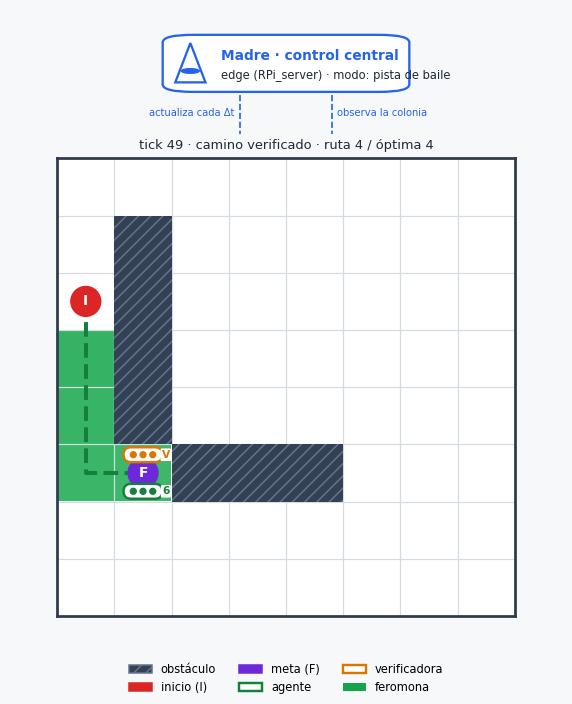
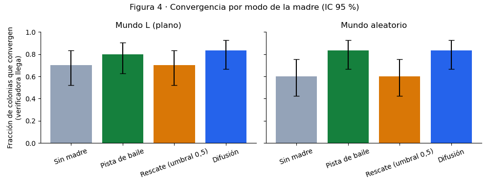
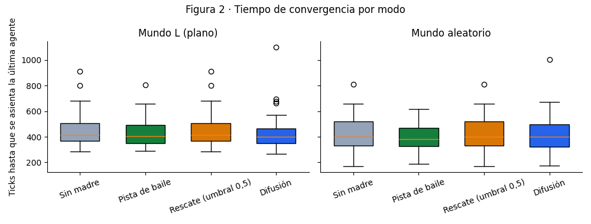
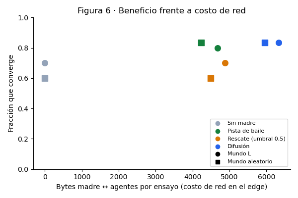
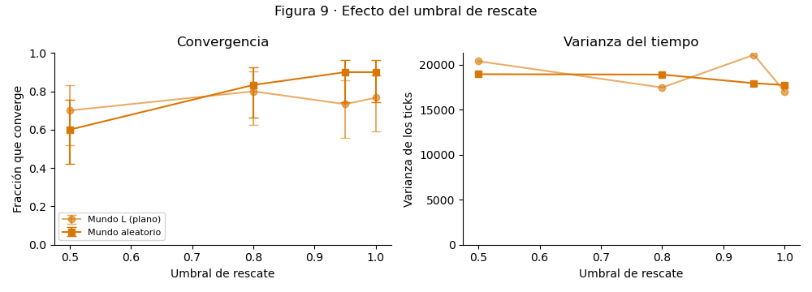

# La colonia y la madre

*Un hormiguero de software, lo que logró, lo que no y un error que nos enseñó a medir mejor.*

## 1. La pregunta

Ponga un nido de hormigas a un lado y comida al otro. Entre los dos, dos puentes: uno corto y uno largo. Ninguna
hormiga tiene un mapa y ninguna da órdenes. Aun así, al cabo de un rato, casi toda la colonia camina por el puente
corto.

Es el experimento del **puente doble** (Goss, Aron, Deneubourg y Pasteels, 1989). El secreto es una señal química,
la **feromona**: cada hormiga deja un poco al caminar, y la que viene detrás tiende a elegir la rama que huele más.
Por la rama corta se va y se vuelve antes, así que allí la feromona se acumula más rápido. Más feromona atrae más
hormigas, que dejan más feromona. Es un círculo que se alimenta a sí mismo: una *retroalimentación positiva*.

Deneubourg y sus colegas (1990) lo escribieron como una fórmula. La probabilidad de elegir una rama crece con su
feromona elevada a un exponente, α, que en las hormigas reales vale cerca de 2. Ese exponente agranda las
diferencias pequeñas. Por eso, si los dos puentes miden lo mismo, la colonia igual termina usando uno solo: cualquiera
de los dos, al azar. A eso se le llama **ruptura de simetría**.

Este proyecto toma esa idea y la lleva a las máquinas. Las hormigas serían **ESP32**, pequeños computadores de un solo
chip que se hablan por radio. Y en el borde de la red habría una **madre**: una Raspberry Pi que no ve el mundo, solo
sabe lo que las agentes le cuentan, tiene una memoria limitada y actúa cada cierto tiempo. El código la describe así:
se parece más a una colmena con su pista de baile que a una reina que da órdenes.

La pregunta es doble. ¿La colonia de máquinas se comporta como la de hormigas? ¿Y la madre ayuda, o solo cuesta
mensajes?

## 2. El gemelo

Antes de soldar un solo cable, el proyecto construyó un **gemelo de software**: una copia en código de todo el
sistema, con el mundo, las agentes, la madre y los mensajes que se envían. El plan tiene tres fases: primero todo en
Python; luego Python con NetLogo y mensajería de red; y al final ESP32 y Raspberry Pi.

¿Por qué empezar por ahí? En software un ensayo se repite idéntico con la misma semilla de azar, se corren cientos y se
comparan con una referencia matemática. Además, varias decisiones de hardware siguen abiertas (lenguaje, medio de
comunicación, inventario de piezas), y el gemelo permite estudiar la idea sin esperarlas.

El punto de partida fue un plano de ensayo:

Una cuadrícula de 8 × 8 con obstáculos en L, un inicio (I), una meta (F) y agentes que dejan feromona. Arriba, la
madre (el plano la llama "reina") observa a la colonia y la actualiza cada intervalo Δt.

En el gemelo, seis agentes salen del inicio una por turno. Cuando una llega a la meta, avisa a la madre (como la abeja
que danza), vuelve al nido dejando feromona y repite el viaje diez veces antes de quedarse en la meta. Una agente solo
distingue 16 niveles de feromona, porque los mensajes de radio deben ser diminutos. Al final sale una **verificadora**:
debe llegar a la meta siguiendo solo el rastro, sin explorar y sin volver sobre sus pasos. Si llega, decimos que la
colonia **convergió**: aprendió un camino que otra puede seguir.

Aquí la verificadora (V, en ámbar) llega por la ruta más corta posible. Hay también una
[animación de un ensayo](../imagenes/ejemplo_ensayo.gif). No siempre sale así de bien.

## 3. Lo que se comprobó contra la referencia

El proyecto parte de unos notebooks de Jupyter que modelan el puente doble. Se tomaron como **oráculo**: el gemelo solo
es correcto si los reproduce dentro de unas tolerancias que se escribieron **antes** de correr nada. Así se evita la
tentación de mover la meta después de ver el resultado.

| Criterio | Qué pregunta | Resultado |
| --- | --- | --- |
| C1 | ¿Las agentes eligen rama con la misma fórmula? | **PASA**: en 31 casos, la mayor desviación es 0,94 en unidades estadísticas (el límite era 4) |
| C2 | Con dos ramas iguales, ¿la colonia rompe la simetría? | **PASA**: el 75 % de los ensayos termina con casi todo el tráfico en una rama (se pedía 70 %), y cada rama gana más o menos la mitad de las veces |
| C3 | Con la rama larga del doble de largo, ¿se prefiere la corta tan a menudo como en el oráculo? | **NO PASA**: gemelo 48 %, oráculo 75 %; la diferencia (0,27) supera la tolerancia (0,15) |
| C4 | ¿El reparto mitad y mitad es inestable? | **PASA**: solo el 6 % de los ensayos acaba entre 40 % y 60 % (se pedía 20 % o menos) |
| C5 | ¿La misma semilla da el mismo resultado? | **PASA** |

La primera comparación fue peor: C2, C3 y C4 fallaron. Las seis agentes salían juntas en el primer instante, cuando aún no había feromona, y cada una elegía rama una sola vez. Ninguna veía el rastro de las
demás. La fórmula estaba bien (C1 pasaba); lo que faltaba era la **interacción en el tiempo**. Con salidas escalonadas
y viajes repetidos, la colonia empezó a romper la simetría como en el notebook.

**¿Y C3?** Se investigó con tres hipótesis escritas antes de probar. La principal resultó ser el número de
**decisiones**: el gemelo toma 300 por ensayo (6 agentes × 50 viajes), mientras que el notebook usa 1000 hormigas. Con
300 decisiones, ni siquiera una agente con percepción perfecta lo logra (41 %). Con unas 1000 decisiones, la percepción
perfecta llega al 65 %, ya dentro de la tolerancia.

La segunda causa aparece justo cuando hay muchas decisiones, y está en cómo la agente mide la feromona. Imagine una
regla con solo 16 marcas: cuando se acumulan muchos depósitos, las dos ramas tocan la última marca y parecen iguales.
Con 1000 decisiones, esa saturación hunde el resultado al 34 %. Con 256 niveles (8 bits) se llega al 62 %; con 16 niveles
espaciados en escala logarítmica, al 58 %, a 0,02 de la tolerancia.

Queda algo sin explicar: incluso en las mejores variantes, el gemelo se queda con la rama **larga** en cerca de uno de cada
tres ensayos; el oráculo, en el 5 %. Una sospecha, **no comprobada**, es que con solo seis agentes los vaivenes del
principio deciden antes de que la rama corta haga valer su ventaja. El operador decidió dejar C3 en NO PASA con la causa
documentada: cambiar ahora la percepción sería ajustar el sistema después de ver el resultado. Se reconsiderará al
llegar al hardware.

## 4. La madre y sus cuatro modos

La madre puede comportarse de cuatro maneras:

- **Ausente:** no hace nada. Es la línea base: solo feromona.
- **Pista de baile:** como en una colmena, anuncia a todas las mejores rutas conocidas y entrega la que cada una pida.
- **Rescate:** solo ayuda a la *rezagada*, la agente con menos experiencia que una fracción del promedio (el
  **umbral**), y le entrega la mejor ruta como punto de partida. Es la idea de la propuesta técnica del proyecto,
  inspirada en la "carrera en tándem" de las hormigas *Leptothorax*, en la que una guía a otra.
- **Difusión:** cada Δt envía a todas el mapa reunido y la mejor ruta.

Cada condición se corrió con 30 semillas en dos mundos: el de la L del plano y uno con obstáculos al azar (siempre con
camino). Cuántas veces llegó la verificadora:

| Modo de la madre | Mundo L | Mundo aleatorio |
| --- | --- | --- |
| Ausente | 21 de 30 | 18 de 30 |
| Pista de baile | 24 | 25 |
| Difusión | 25 | 25 |
| Rescate, umbral 0,5 | 21 | 18 |
| Rescate, umbral 0,8 / 0,95 / 1,0 | 24 / 22 / 23 | 25 / 27 / 27 |

*Nota sobre las figuras de esta sección (2026-11-20).* Vienen del notebook de análisis, que se reorganizó para explicar
primero un ensayo (ver [«Repetir el azar, mirar por dentro»](03_repetir_el_azar.md)). Por eso el título que llevan
dentro de la imagen dice ahora "Figura 4", "Figura 5", "Figura 6" y "Figura 9". Son las mismas cuatro figuras, con los
mismos datos; solo cambió el número.

La tendencia es que la madre ayuda, sobre todo en el mundo aleatorio. Pero con 30 semillas la tendencia **no alcanza
a ser una conclusión**. El caso más llamativo, rescate con umbral 0,95 frente a madre ausente (27 contra 18 de 30), da
p = 0,015. Como se hicieron seis comparaciones, y con seis intentos alguna puede salir llamativa por pura suerte, se
aplica una corrección (Bonferroni) que exige más a cada una. Corregido, p = 0,09: **no es significativo**. Los márgenes
de confianza lo dicen también: 74–97 % para 27 de 30 y 42–75 % para 18 de 30 se tocan.

La propuesta técnica tenía una hipótesis más precisa: que el rescate **reduce la variación** del tiempo que tarda la
colonia en converger. Los datos **no la apoyan**: en las seis comparaciones, p corregido = 1,00. Algo parecido pasó con
la pista de baile y la difusión: en una configuración anterior, con un solo viaje por agente, bajaban esa variación a
menos de un tercio; con diez viajes, el efecto desapareció. (El registro lo confirmó después, F-027: aquel resultado
vale solo para la configuración anterior, que no se repitió.)

Y nada es gratis. Sin madre no hay mensajes con ella; con madre, cada ensayo cuesta entre unos 4200 y 6300 bytes de
tráfico entre la madre y las agentes. En una red de radio, eso es energía.

## 5. Una historia honesta de error

Durante dos días, el registro del proyecto dijo que, con el umbral 0,5, **el rescate no se disparaba**. La prueba parecía
sólida: los resultados coincidían con los de la madre ausente.

La pista llegó de fuera. Otro modelo de inteligencia artificial, Gemini, había construido su propio motor para el
mismo gemelo y había anotado que el modo rescate emitía 23 envíos de rescate que no cambiaban nada. Lo
atribuyó a que llegaban tarde. Al revisarlo con nuestro código apareció la causa real: **la madre rescataba a la
verificadora**. La verificadora informa su estado como cualquier agente; recién salida tiene poca experiencia, y la
madre la tomaba por rezagada. En la configuración de las primeras pruebas, la madre envió rescates en 26 de 30 ensayos,
y **los 26 fueron a la verificadora**, que los ignora.

El rescate sí se disparaba. Iba a la agente equivocada. Gemini vio el síntoma; ninguno de los dos vio la causa.

El error de fondo fue de método: se dedujo que un mecanismo no actuaba porque el resultado no cambiaba, **sin contar
los envíos**. El otro trabajo sí guardaba esa cifra, y por eso el síntoma salió a la luz. La comparación dejó además una
buena noticia: los dos motores, escritos por separado, dieron exactamente los mismos tiempos y tasas.

Se corrigió el defecto y se repitieron los 480 ensayos, esta vez con las pruebas declaradas antes de correr. Ningún
rescate llegó a la verificadora. Con umbral alto, la madre envió entre 79 y 129 rescates por cada 30 ensayos; entre el
71 % y el 83 % se usaron, y el resto llegó tarde: la agente ya había llegado a la meta al menos una vez. Los resultados salieron **idénticos fila por fila** a los de antes:
las cifras se sostienen; lo que cambió fue la lectura del mecanismo. Con umbral 0,5, el rescate nunca ayudó porque no llegaba a ninguna agente útil.

La lección quedó escrita en el registro: **medir cada mecanismo** (envíos, usos y descartes), no inferirlo del
resultado. Un resultado igual puede esconder un mecanismo roto.

## Lo que aprendimos

- La regla de decisión de las hormigas se reproduce en el gemelo (C1), pero no basta: sin interacción en el tiempo,
  sin agentes que vean el rastro de las anteriores, no hay comportamiento de colonia.
- Con pocas decisiones y una percepción de 16 niveles, el gemelo prefiere la rama corta con menos fuerza que el modelo
  de referencia (C3 NO PASA), y ya se sabe por qué en buena parte.
- Que un resultado no cambie no prueba que un mecanismo no actúe: hay que contarlo.

## Lo que todavía no sabemos

- Si la madre mejora de verdad la convergencia. La tendencia existe, sobre todo en el mundo aleatorio, pero no es
  significativa con 30 semillas; harían falta unas 100 por condición, con las pruebas declaradas antes.
- Por qué el gemelo se queda con la rama larga en cerca de un tercio de los ensayos, incluso con muchas decisiones.
- Si el rescate puede reducir la variación del tiempo de convergencia con otra configuración: con la actual, no lo hace.

## Fuentes

- Puente doble y fórmula de Deneubourg: `referencia/ACO/experimento_doble-puente/deneubourg_puente_doble.ipynb`
  (celdas de introducción).
- Proyecto, fases y madre: `CONTEXT.md` (§7 y §8), `gemelo/aco_gemelo/madre/madre.py` (descripción de los modos),
  `ESTADO-PREHARDWARE.md` (bloqueantes B1–B6).
- Plano e imágenes: `bosquejo/Plano de ensayo · ACO en edge.png`, `gemelo/docs/imagenes/`.
- Ciclo de las agentes y verificadora: `DECISIONES-PRUEBA.md` (D3, E3, G1, J1, J2, J7), `gemelo/configs/default.yaml`.
- Criterios C1–C5: `oraculo/RESULTADOS.md`, `oraculo/TOLERANCIAS.md`; primera comparación: `FAILURES.md` (F-014, F-015).
- Investigación de C3: `oraculo/INVESTIGACION-C3.md`, `FAILURES.md` (F-017), `DECISIONES-PRUEBA.md` (J8).
- Modos de la madre: `gemelo/experimentos/datos/modos/resumen.csv`, `gemelo/experimentos/datos/rescate/resumen.csv`,
  `FAILURES.md` (F-013, F-018, F-019, F-027), `gemelo/docs/informes/experimento_modos.md`,
  `gemelo/notebooks/analisis.ipynb`, `gemelo/notebooks/figuras/` y `gemelo/notebooks/README.md` (numeración de las figuras).
- Error del rescate: `FAILURES.md` (F-020, F-021), `otras/ANALISIS-gemini-artefacto9.md`,
  `gemelo/docs/informes/rescate_tras_F020.md` (tabla de mecanismos: usados de 86 de 121, el 71,1 %, a 79 de 95, el 83,2 %) y
  `gemelo/docs/informes/experimento_rescate.md` ("llega tarde" = `rescate_ya_llego`; F-028).
