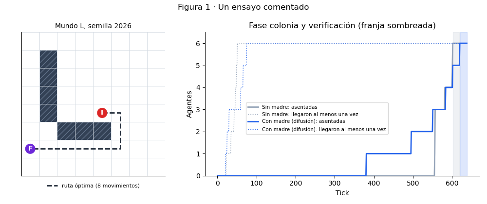
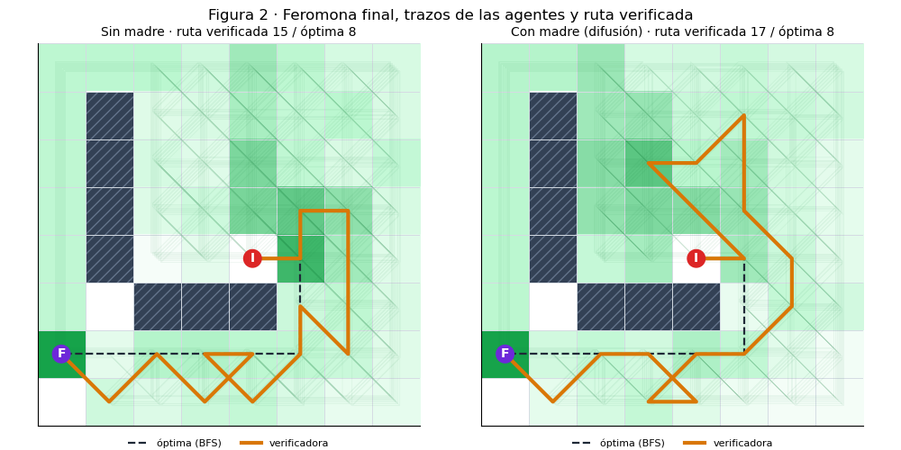
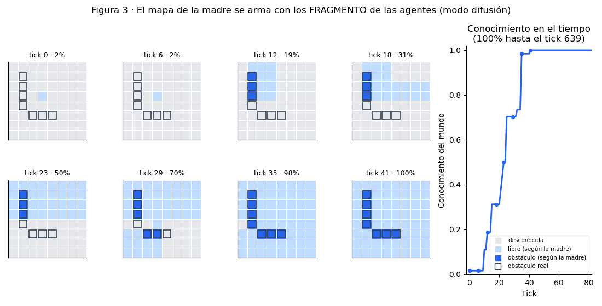
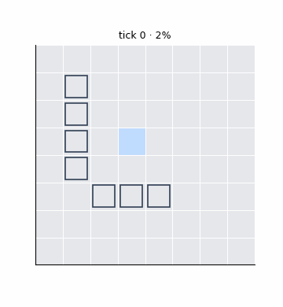
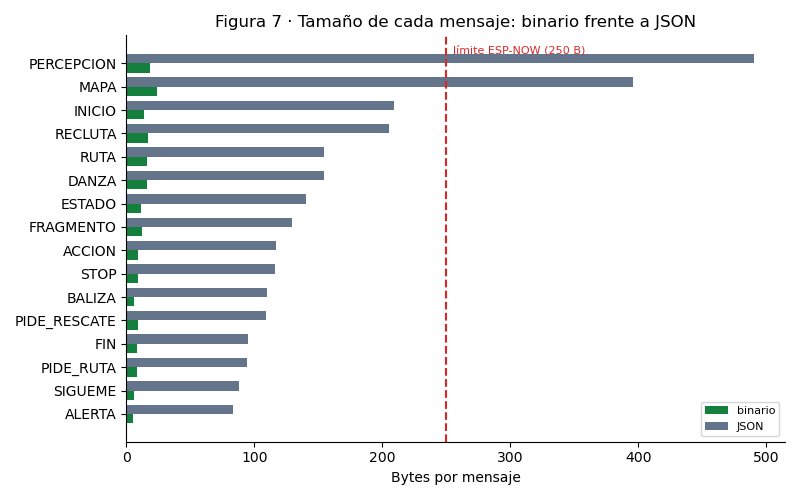
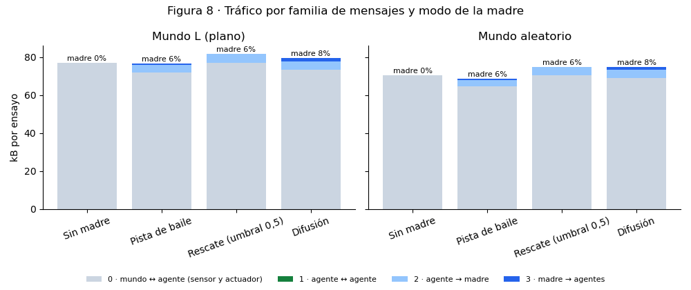

# Repetir el azar, mirar por dentro

*Qué pasó desde [«Novedades: un equipo en el laboratorio»](02_novedades.md) (sesiones del 19 y el 20 de noviembre de
2026): un defecto que solo aparecía cuando la red fallaba, un arreglo que trajo otro defecto, un notebook que ahora
enseña lo que pasa dentro de un ensayo y una afirmación vieja que se retira en público.*

## 1. La pregunta

Ninguna colonia de hormigas se repite. Si mañana pusiera el mismo nido frente a la misma comida, las exploradoras
saldrían en otro orden, tomarían otros desvíos y quizá eligieran otro camino. En la naturaleza, el azar no tiene
botón de "otra vez".

En un gemelo de software sí debe tenerlo. Todo el azar del gemelo sale de una **semilla**: un número que fija la
secuencia de "tiradas de dado" de un ensayo. Misma semilla, mismo ensayo, tirada por tirada. Sin eso no se puede
comparar un modo de la madre con otro ni repetir un experimento para comprobarlo. Es el criterio C5 del proyecto, y
pasaba.

La pregunta de estas dos sesiones fue más incómoda: **¿se sigue repitiendo cuando la red falla?**

## 2. Una carrera en la entrada del hormiguero

El gemelo tiene un motor con **hilos**: cada agente corre como un programa aparte y la madre como otro, igual que lo
harían varios microcontroladores independientes. Sus mensajes viajan por una red simulada que puede **perder**
mensajes (en la prueba, el 20 %) o **retrasarlos** (de 1 a 3 pasos del reloj, que el gemelo llama *ticks*).

El revisor, el agente que verifica sin conocer el razonamiento de quien construyó, encontró que con pérdidas o retardo
ese motor no se repetía. Antes de corregir, el experimentador lo midió: con pérdidas, en **71 de 240** ensayos dos
corridas idénticas, con la misma semilla, dieron resultados distintos; con retardo, en **37 de 240**. Con la red
ideal, sin fallas, en ninguno.

La causa era una carrera. Todas las agentes compartían un solo dado para decidir qué mensaje se perdía o se retrasaba. Quien llegaba
primero al dado se llevaba el primer número, y quién llegaba primero dependía de cómo el computador repartía el
turno entre los hilos. Es como un túnel estrecho a la entrada del hormiguero: si el orden en que entran las obreras
cambia lo que le pasa a cada una, el día no se puede repetir. Sin madre ningún ensayo cambiaba, porque no había
mensajes con ella que se pudieran desordenar.

Ese fue el primero de **8 defectos** que el revisor encontró en el bloque B + C (mejoras del motor y de las
métricas), con las **281 pruebas** automáticas en verde. Los otros siete: el mensaje que arranca cada ensayo (`INICIO`) gastaba números del dado de la red y cambiaba
resultados cuando había pérdidas o retardo; un ensayo interrumpido rompía el dibujo; un mundo con el inicio en la
misma celda que la meta se aceptaba y hacía caer a la madre en el modo pista de baile; con retardo, la medida de lo
que sabe la madre podía desalinearse; un valor de configuración demasiado grande hacía fallar el ensayo; había errores
de documentación; y **tres pruebas pasaban aunque faltara justo lo que decían comprobar**. Para verlo, el revisor usó *mutantes*: copias del código a las
que se les quita a propósito una mejora. Si la prueba sigue en verde con el mutante, no estaba mirando.

Un detalle de método: el informe original del revisor se perdió al cerrar la sesión del 18 de noviembre. Al día
siguiente lo rehízo con una reproducción de cada defecto, y desde entonces los informes se guardan en el repositorio.

## 3. El arreglo y su efecto secundario

La corrección: **un dado propio para cada emisor** y una entrega en orden fijo (primero por el tick de llegada, luego
por el de envío, luego por quién lo envió). Así no importa quién gane la carrera. Con ese cambio, las diferencias
entre dos corridas iguales bajaron a **0 de 240** con pérdidas, con retardo y con la red ideal.

Pero el arreglo trajo un defecto nuevo, y no lo vio quien lo escribió. El dado de la red de cada agente se fabricaba
con la misma receta que el dado de sus propias decisiones (semilla × 256 + número de la agente). Eran, en la práctica,
**el mismo dado**. La tirada que decidía el primer papel de una agente era la misma que decidía si su primer mensaje se
perdía. Imagine una abeja cuya elección de flor y la suerte de su danza dependieran de la misma moneda: las dos cosas
quedarían atadas sin que nadie lo hubiera querido. Con la red ideal no influía en nada (lo comprobó el revisor).

El revisor lo atrapó en la segunda ronda. El registro lo anota como falla de la IA que construye: copió la receta sin
revisar con qué más chocaba. El nuevo arreglo le pone **una etiqueta propia** a la semilla de la red ("canal"), de modo
que su dado deja de fabricarse con la receta de las agentes y del mundo. En la tercera ronda, el revisor sacó 3000
números de cada dado de la red en 12 semillas distintas, incluidas el 0 y varias negativas, y no encontró **ningún
valor compartido** con las agentes ni con el mundo. Comparó además el motor de hilos con el motor de un solo hilo en
576 ensayos: **0 diferencias**. Veredicto: **PASA**. El bloque B + C quedó cerrado con 318 pruebas del gemelo en verde.

Dejó dos observaciones leves, que siguen abiertas: ninguna prueba vigila que el resultado se repita entre procesos
distintos del computador, y la semilla −3 produce el mismo mundo que la 3 (no afecta a los experimentos publicados,
que usan las semillas 0 a 29).

*(Actualización, 2026-11-25: las dos quedaron cerradas. Una prueba nueva compara el mismo ensayo en tres procesos y las
semillas negativas se rechazan. Al cerrarlas apareció una regresión, que atrapó el QA externo. Se cuenta en
[«El punto ciego»](04_el_punto_ciego.md).)*

## 4. ¿Cambió algo de lo publicado?

Antes de tocar el código, el experimentador guardó una **línea base**: el "antes", para poder decir con números qué
cambió.

- Los experimentos ya publicados (los modos de la madre y el umbral del rescate) usan la red ideal. Repetidos con el
  código corregido, sus **18 archivos de datos salieron idénticos byte a byte**. Ninguna conclusión publicada cambia.
- Con pérdidas o retardo sí cambiaron ensayos sueltos (146 y 118 de 240), porque cambió quién usa qué tirada del dado.
  Las tasas de convergencia y los tiempos no mostraron diferencia (el menor valor p fue 0,33 en las tasas y 0,56 en
  los tiempos). Esa comparación es
  **exploratoria**: no se declaró antes de correr.

Lo que este arreglo garantiza es que la red *simulada* se repite. No dice nada sobre el orden en que llegan los
mensajes en una radio real.

## 5. Mirar un ensayo por dentro

El bloque D se propuso algo distinto: que el notebook de análisis, antes una colección de estadísticas, **explique un
ensayo**. Toma un solo mundo con una sola semilla, la que trae la configuración por defecto (2026), y lo corre dos veces:
sin madre y con la madre en modo difusión. La regla fue usar la semilla de la configuración por defecto, sea cual sea el resultado. Según el registro (F-028), se
declaró antes de correr, pero solo quedó escrita en el notebook, sin marca de hora propia; por eso el revisor no pudo
comprobar que se fijara antes de ver el resultado.

La línea punteada de la izquierda es la ruta más corta posible, 8 movimientos. A la derecha, el reloj de la colonia:
cuántas agentes ya llegaron a la meta y cuántas terminaron sus diez viajes y se quedaron allí. En este ensayo la
colonia **sin** madre terminó antes sus viajes (603 ticks frente a 621) y su verificadora, la agente que sale al final a seguir solo
el rastro, hizo una ruta más corta (15 movimientos frente a 17).

¿Quiere decir que la madre estorba? No. **Una corrida suelta no dice qué modo es mejor**, del mismo modo que un día de
lluvia no dice cuál es el clima de una ciudad. Para eso están las 240 corridas del experimento de los modos de la madre, y ni siquiera ellas
alcanzan para una conclusión firme (ver [«La colonia y la madre»](01_la_colonia_y_la_madre.md), sección 4).

Aquí está el rastro. El verde es la feromona al final; las líneas finas, por dónde anduvieron las seis agentes; la
línea ámbar, la ruta de la verificadora. Las dos verificadoras llegan, pero ninguna por la ruta óptima. Cada viaje
deja en cada celda de su ruta más feromona cuanto más corta es la ruta (255 ÷ largo), pero el total por viaje es casi el
mismo: solo se concentra. Y el rastro se evapora un 1 % por tick. Por eso un camino largo muy recorrido puede acumular
más que uno corto poco usado. **Por qué la colonia se queda a veces con un camino largo no está medido**: es la misma
pregunta abierta del criterio C3. Un aviso: el color se ajusta al máximo de cada panel, así que la intensidad no se
compara entre los dos.

## 6. Lo que sabe la madre

La madre no ve el mundo. En los modos difusión y rescate, cada agente le manda **fragmentos de su mapa**: qué celdas vio
y cuáles son obstáculo. Con eso la madre se arma un mapa interior, como una colmena que se forma una idea del paisaje
solo con lo que cuentan las abejas que vuelven.

El gris es lo que todavía no sabe; el azul claro, lo que cree libre; el azul fuerte, lo que cree obstáculo; los
recuadros oscuros, los obstáculos reales. El **conocimiento** se mide como la fracción de las 64 celdas que la madre
conoce y clasifica bien. En este ensayo va de casi nada en el tick 0 al 50 % en el tick 23, al 98 % en el 35 y al
**100 % en el tick 41**. Para entonces todavía no habían llegado a la meta las seis agentes: la sexta llegó en el
tick 75. Y la madre nunca marcó como obstáculo una celda libre.

Hay una [animación del mismo mapa, con un cuadro cada 5 ticks](../../notebooks/figuras/f7_conocimiento_de_la_madre.gif):

Es un solo ensayo, en un mundo pequeño de 8 × 8. Cuánto tarda la madre en conocer mundos más grandes o más
enredados no se ha medido.

## 7. ¿Cabe en un paquete de radio?

Uno de los medios de radio que se consideran para las ESP32 es **ESP-NOW**, que lleva como máximo 250 bytes por paquete.
Los mensajes del gemelo se pueden escribir en dos formatos con la misma información: **binario**, apretado, y **JSON**,
texto legible por personas.

En binario, los mensajes de ejemplo miden entre 5 y 24 bytes; el mayor calculado, el mapa con feromona incluida, 56. En
JSON son entre 9,6 y 27,2 veces más grandes, y dos no caben en un paquete: la percepción de una agente (490 bytes) y el
mapa que difunde la madre (396). Conclusión del notebook: si el transporte es ESP-NOW, el formato tiene que ser binario. El informe lo matiza: en el
hardware la percepción no viajaría por radio (se explica abajo); el mapa de la madre sí.
Hay una complicación más: la Raspberry Pi no habla ESP-NOW, así que haría falta una ESP32 de pasarela. Todo esto
depende de un protocolo que sigue en borrador (v0.3) y sin aprobar.

La segunda figura muestra de dónde sale el tráfico. Entre el 92 % y el 100 % de los bytes de cada condición es la
conversación del mundo con cada agente: lo que percibe y lo que hace, tick a tick. En una ESP32 real eso es leer
sensores y mover motores dentro del mismo chip, sin radio. Lo que sí viajaría por radio, entre la madre y las agentes,
suma entre unos 4,2 y 6,3 kilobytes por ensayo. Cuántos bytes por segundo son, no se sabe todavía: nadie ha fijado
cuánto dura un tick.

## 8. Una afirmación que se retira

El 17 de noviembre el registro anotó (F-013) que la madre, en los modos pista de baile y difusión, **reducía a menos de
un tercio** la variación del tiempo que tarda la colonia en asentarse. Era una lectura atractiva: parecía la hipótesis
de la propuesta técnica del proyecto.

Ese mismo día, a las 04:49, el registro ya había advertido (F-018) que con diez viajes la madre no reducía la
variación de forma detectable. Al escribir los informes del bloque D, el experimentador lo volvió a comprobar con los
datos actuales. Aquella medición se hizo con un solo viaje por agente y sin evaporación; hoy cada agente hace diez
viajes y el rastro se evapora. Con la configuración actual, la desviación típica del tiempo con madre va de 112 a
169 ticks, frente a 140–145 sin madre; en difusión es incluso mayor que sin madre; y la prueba estadística da
p = 1,00 tras corregir por comparaciones múltiples. El registro (F-027) deja F-013 como resultado de **aquella**
configuración, que no se repitió. El texto [«La colonia y la madre»](01_la_colonia_y_la_madre.md) ya decía que el
efecto desaparecía con diez viajes; ahora lo respalda un informe.

## 9. Cuando el texto dice más que el dato

Lo técnico del bloque D pasó la revisión a la primera: el notebook se regenera desde cero con figuras idénticas byte a
byte y las cifras salen de los datos. Lo que no pasó fueron **las frases**. Algunos ejemplos que encontró el revisor:

- Se dijo que, en el ensayo comentado, las rutas medían "el doble de la óptima o más"; la razón sin madre es 1,88.
- Se explicó la elección de un camino largo con un mecanismo ("el primer camino reforzado tiende a ganar") que nadie
  ha medido.
- Se dijo que el tráfico del mundo era "entre el 94 y el 100 %"; en difusión es el 92 %.
- Al corregir, una frase nueva sobre la feromona ("cada viaje deposita más cuanto más corta es su ruta") resultó falsa
  por viaje y olvidaba la evaporación. Hicieron falta tres pasadas; lo que cerró el ciclo fue usar, sin cambios, la redacción que propuso el propio revisor.
  Esa última corrección no tuvo una cuarta pasada, por decisión del operador.

El registro (F-028) lo llama un patrón repetido: los textos explicativos de la IA que construye tienden a afirmar más
de lo que el dato sostiene. **Las pruebas automáticas no lo atrapan; el revisor sí.** Una prueba comprueba que un número
sale igual; no puede leer si la frase que lo rodea dice la verdad.

La lección también es para este texto, que escribe una IA del mismo tipo. Por eso cada cifra de arriba se puede
rastrear a un archivo del repositorio, y lo que no se pudo comprobar está escrito como pregunta.

## 10. Lo que cuesta verificar

Este proyecto es el **tercer uso** de un protocolo de trabajo con IA. Los dos anteriores fueron simulaciones de
análisis; el documento que evalúa el método no los describe, porque la IA no tiene acceso a ellos. En este caso, según
ese documento, se usaron agentes con papeles fijos.

El documento también lleva la cuenta del gasto. En la sesión que empezó el 19 de noviembre y siguió hasta la
madrugada del 20, ocho tareas de
los agentes revisor y experimentador consumieron cerca de **697 000 tokens** (las unidades de texto que procesa el
modelo) y 266 llamadas a herramientas. Su conclusión es prudente: no hay evidencia de que los agentes ahorren; cada uno
vuelve a leer lo que la IA principal ya sabía. Se justifican por otra cosa: la primera revisión encontró 8 defectos con
las pruebas en verde; la segunda, un defecto que la corrección había introducido; y las del bloque D, frases que
afirmaban de más.

## 11. Lo que viene

> **Actualización (2026-11-25).** Antes de la guía de reproducción hubo un paso que este texto no preveía: el 25 de
> noviembre entró al equipo un segundo modelo de IA, Gemini, como QA externo (ADR-004), y en sus rondas 001 y 002 se cerraron
> las dos observaciones leves de la sección 3 (F-029). Al cierre de ese día: 347 pruebas del gemelo y 7 del oráculo en PASA,
> más 87 pruebas de QA, y los experimentos publicados sin cambios. La guía de reproducción sigue siendo el siguiente
> paso, ahora como ronda 003 de QA. Todo eso se cuenta en [«El punto ciego»](04_el_punto_ciego.md). Lo de abajo se deja
> como estaba escrito el 20 de noviembre.

El orden aprobado: primero una **guía de reproducción**, que el revisor deberá seguir desde cero para comprobar que
cualquiera puede repetir los resultados; luego, poner al día los registros; después, la demostración con NetLogo, en la
que el mundo correrá en otro programa y los mensajes saldrán por primera vez de la memoria de un solo proceso. Los seis
bloqueantes para el hardware siguen abiertos.

## Lo que aprendimos

- Un sistema puede ser reproducible con la red perfecta y dejar de serlo cuando la red falla. Ahora la red simulada se
  repite también con pérdidas y retardo (0 diferencias en 240 ensayos por tipo de red), y los resultados publicados no
  cambiaron (18 archivos idénticos byte a byte).
- Una corrección puede traer su propio defecto: dos dados que parecían independientes eran el mismo. Lo encontró quien
  no había escrito el código.
- Una corrida suelta enseña cómo funciona el sistema, pero no qué modo es mejor; y una afirmación que no se repite con
  la configuración actual (F-013) se retira, aunque fuera atractiva.

## Lo que todavía no sabemos

- Si la madre mejora de verdad la convergencia: sigue pendiente un experimento confirmatorio con unas 100 semillas por
  condición y las pruebas declaradas antes.
- Cómo afectan la pérdida y el retardo de mensajes a la convergencia: los ensayos con red imperfecta se hicieron para
  comprobar que se repiten, no para medir ese efecto. Y nada de esto dice cómo se comporta una radio real.
- Por qué la colonia se queda a veces con un camino largo, y cuántos bytes por segundo usaría en el hardware (falta fijar
  la duración de un tick).

## Fuentes

- Defectos del bloque B + C y su corrección: `FAILURES.md` (F-023, F-024, F-025, F-026);
  `gemelo/docs/informes/revision_F023.md`, `revision_F024.md` y `revision_F025.md`.
- Línea base y reproducibilidad con pérdidas y retardo: `gemelo/docs/informes/experimento_reproducibilidad_canal.md`.
- Pérdida del informe del revisor: `gemelo/docs/informes/revision_F023.md` (encabezado), `USO-DEL-PROTOCOLO.md` (§3).
- Notebook y figuras: `gemelo/notebooks/analisis.ipynb` (secciones 1 a 3 y 5, salidas de las celdas),
  `gemelo/notebooks/README.md`, `gemelo/notebooks/figuras/` (f5 a f9 y el GIF); comprobaciones del mapa de la madre en
  `gemelo/docs/informes/revision_D.md`.
- Tamaños de mensaje y tráfico: `gemelo/docs/informes/tamanos_de_mensaje.md`, `gemelo/docs/informes/experimento_modos.md`.
- F-013 retirado: `FAILURES.md` (F-013, F-027), `gemelo/docs/informes/experimento_modos.md` (diagnóstico).
- Textos que afirmaban de más: `FAILURES.md` (F-028), `gemelo/docs/informes/revision_D.md` (tres pasadas).
- Protocolo de trabajo, agentes y tokens: `USO-DEL-PROTOCOLO.md` (encabezado, §5).
- Lo que viene: `CLAUDE.md` ("Para retomar", estado al 2026-11-20), `ESTADO-PREHARDWARE.md` (B1–B6).
- Actualizaciones del 2026-11-25: `DECISIONS.md` (ADR-004), `FAILURES.md` (F-029), `.handoff/rondas/002-reporte_qa.md`,
  `CHANGELOG.md` (sesión 5), `CLAUDE.md` (historial del 2026-11-25, 21:02).
