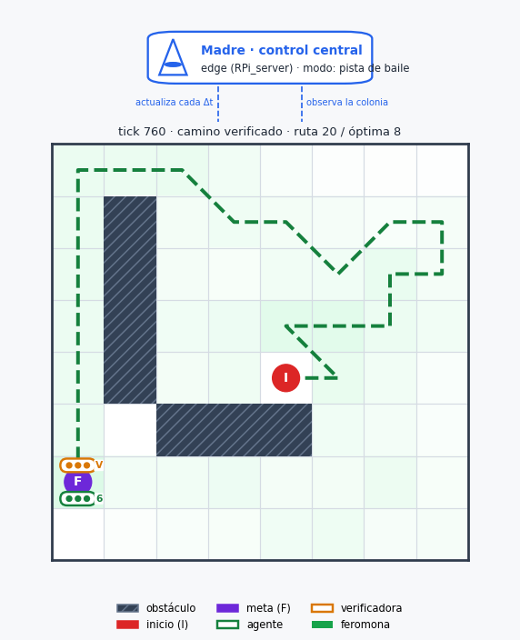
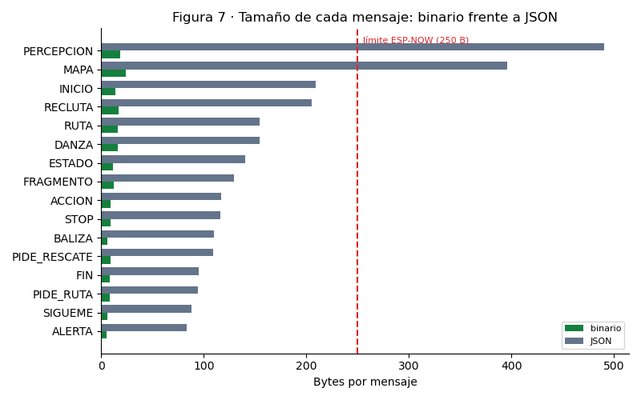

# Una danza para desconocidos

*Qué pasó la noche del 25 de noviembre de 2026 (sesión 5), desde [«El punto ciego»](04_el_punto_ciego.md): el gemelo
ganó una guía para que cualquiera lo reproduzca desde cero, el revisor encontró que el comparador de imágenes de esa
guía no veía los colores, el QA externo la siguió desde un clon con un entorno creado de nuevo, y un error de este mismo
cuaderno salió a la luz.*

## 1. La pregunta

Una abeja exploradora encuentra flores lejos de la colmena. Vuelve y baila. Su danza dice hacia dónde y a qué distancia
están, y otras obreras que nunca vieron esas flores salen y las encuentran. La danza no sirve si las reclutas llegan a
"unas flores parecidas": sirve si llegan **al mismo sitio**.

La ciencia tiene una exigencia parecida. Un resultado empieza a contar cuando alguien que no estuvo allí lo repite,
siguiendo solo lo que quedó escrito.

La pregunta de esta noche fue: **¿puede alguien que no escribió el gemelo obtener exactamente lo mismo, solo con lo que hay
en el repositorio?**

## 2. Qué quiere decir "lo mismo"

La respuesta es la **guía de reproducción**, `gemelo/REPRODUCIR.md` (el artefacto 17 del proyecto). Va paso a paso:
clonar el repositorio, crear el entorno de programas con sus versiones fijas, correr las pruebas, correr un ensayo de
referencia y comparar.

El ensayo de referencia es el mundo en forma de L del plano de ensayo, con la configuración por defecto: semilla 2026,
6 agentes, 10 viajes cada una y la madre en modo pista de baile. Según la guía, las agentes se asientan en la meta en el
tick 739 y la verificadora, la agente que sale al final a seguir solo el rastro, llega por una ruta de 20 movimientos
cuando la más corta mide 8.

Esa ruta 2,5 veces más larga que la óptima no es un error de la reproducción. La guía lo advierte: un solo ensayo no dice
qué tan bueno es un modo de la madre.

Lo importante es la comparación. Un programa, `gemelo/reproducir/comparar.py`, corre ese ensayo y un lote corto de 10
semillas (de la 0 a la 9) en una carpeta temporal, y compara lo que sale con una salida de referencia guardada en el
repositorio (`gemelo/reproducir/esperado/`). La exigencia es **igualdad**, no parecido:

- el texto que imprime el ensayo, línea por línea (solo se deja fuera la línea que dice en qué carpeta quedó la imagen,
  porque la carpeta temporal cambia cada vez);
- el archivo de datos (CSV) del lote, línea por línea;
- la imagen final (PNG), punto por punto.

Con la opción `--completo` compara además los **18 archivos de datos** de los experimentos publicados, que salen de 480
ensayos y son la base del notebook de análisis. Y la guía tiene un paso opcional: volver a ejecutar el notebook y la
comparación con el oráculo (los notebooks de referencia del puente doble). Las salidas del notebook deben quedar iguales,
salvo las marcas de hora de ejecución, y el archivo de resultados del oráculo, sin un solo cambio.

¿Por qué se puede exigir tanto? Porque el gemelo fija todo su azar con la semilla (misma semilla, mismo ensayo, el
criterio C5) y el entorno fija las versiones de las librerías. Con un matiz que la guía declara: `environment.yml` fija
las librerías que el gemelo usa directamente, no todas las que esas librerías traen consigo.

## 3. Las reglas antes del juego

Antes de escribir la guía quedaron anotados cuatro criterios para juzgarla, en `ARTEFACTOS.md`, con la hora 21:36:

- **17.1** Dice qué programas hacen falta, con sus versiones, y deja aparte lo de las fases futuras (NetLogo, ESP32,
  Raspberry Pi).
- **17.2** Alguien que no la escribió la sigue desde cero y obtiene la salida de referencia y los resultados publicados.
  Lo comprueban el revisor y QA, cada uno por su cuenta.
- **17.3** Explica el porqué de cada paso e incorpora los experimentos previos del repositorio de referencia, con su
  fuente.
- **17.4** No depende de nada de internet, fuera de clonar el repositorio y descargar los paquetes del entorno.

Un detalle de honestidad: el revisor anotó que solo pudo ver la hora del archivo, no comprobar que los criterios se
escribieran antes que la guía.

## 4. Un portero ciego al color

Entre las 21:45 y las 22:15, aproximadamente, el revisor (el agente que verifica sin conocer el razonamiento de quien construyó) siguió la
guía desde un clon del repositorio. Usó el entorno que ya existía en la máquina; no creó uno nuevo. La reproducción salió
completa: el texto, el CSV, la imagen, los 18 archivos publicados, el notebook y el oráculo.

Pero el revisor no se queda en "funciona". Fabricó *mutantes*: copias de la salida con un defecto puesto a propósito,
para ver si el comparador lo nota. Con el texto alterado, el comparador dijo NO PASA. Con el CSV alterado, también. Con un
archivo publicado alterado, también. **Con la imagen alterada, dijo PASA.**

Para entender por qué, hay que saber cómo guarda sus puntos una imagen PNG de este tipo (RGBA). Cada punto tiene cuatro
números: rojo, verde, azul y un cuarto, *alfa*, que dice cuánta transparencia tiene. La función que se usó para comparar
(`ImageChops.difference(...).getbbox()`, de la librería Pillow) solo miraba el canal alfa con imágenes RGBA, en la versión
10.4 que usa el gemelo. Así, una imagen **toda negra** "pasaba", y también una con un punto de otro color.

Una colmena tiene guardianas en la entrada que reconocen a sus hermanas por el olor. Una guardiana que solo mirara la
silueta de quien llega dejaría entrar a cualquier insecto del mismo tamaño. Eso era el comparador: miraba la silueta y no
el color.

La guía prometía "PNG, píxel a píxel", y no era cierto. La prueba automática del comparador solo alteraba el CSV, así que
tampoco lo habría notado. El comparador y esa prueba los escribió Claude, la IA que construye. Lo encontró el revisor,
**antes** de entregar la guía a QA. El registro de fallas lo anota como F-031.

El revisor encontró además otras cosas, menores: la guía prometía 347 pruebas y salían 349 (con las 3 pruebas de la guía,
al final, 350); y 7 frases decían más que su fuente, el patrón que el registro llama F-028. Las frases se corrigieron, con la redacción del propio revisor donde la dio.

La corrección del comparador, de la orquestadora (Claude), quedó lista a las 22:28: comparar el tamaño, el tipo de imagen
y **los bytes de los cuatro canales**. Y una prueba nueva que cambia el rojo de **un solo punto** de la imagen de
referencia, sin tocar su transparencia, y exige que el comparador lo note. Según el registro, la función vieja daba la
imagen por igual con un punto cambiado y con una imagen negra; la nueva, no.

El registro deja la lección en una frase: una comparación de "igualdad" también necesita su mutante. Una prueba que dice
"esto es igual a aquello" puede fallar en silencio de la misma manera que el código que vigila.

La versión corregida no tuvo otra pasada del revisor. Esa comprobación quedó para QA.

## 5. Un segundo par de ojos, desde cero

QA es **Gemini**, un modelo de IA de otra empresa que audita el trabajo por rondas (se cuenta en «El punto ciego»). La
guía fue su ronda 003. Lo que hizo, según su reporte:

- Clonó el repositorio en una carpeta temporal. No pudo clonarlo desde GitHub, como dice el primer paso, porque la guía
  aún no estaba publicada: clonó la copia local y le aplicó los cambios que todavía no estaban guardados en el historial.
- **Creó un entorno nuevo** con `conda env create -f gemelo/environment.yml`, justo lo que la revisión interna no había
  probado. Tardó unos 397 segundos. Python salió en la versión 3.12.7 y los 13 paquetes declarados, en las versiones
  exactas. Dentro de ese entorno, el comparador dio tres PASA.
- En el clon: 350 pruebas del gemelo y 7 del oráculo en PASA; la tabla del ensayo de referencia, igual a la de la guía;
  con `--completo`, 9 de 9 archivos iguales en cada uno de los dos experimentos publicados; el notebook, sin cambios
  salvo las marcas de hora y sin cambios en sus figuras; el oráculo, unos 12 minutos de cálculo y su archivo de
  resultados sin un solo cambio.
- Escribió 11 pruebas propias. Nueve atacan el comparador: texto alterado, CSV alterado, un archivo publicado alterado o ausente, y cinco cambios de imagen (un punto de otro color con la misma transparencia, una imagen negra, un punto con otra transparencia, otro tipo de imagen y otro tamaño). El comparador los detectó todos. Las otras dos revisan la guía: sus enlaces y que la tabla del ensayo de referencia coincida con la salida guardada.
- Revisó los 35 enlaces internos de la guía (todos existen) y que no tuviera enlaces externos, fuera de la dirección para
  clonar.

A las 23:06 llegó su veredicto: **PASA**. Doce puntos en PASA, ninguno en NO PASA y dos **NO PROBADOS**: clonar desde
GitHub y repetirlo en otra máquina u otro sistema operativo. Dejó dos observaciones cosméticas (una importación que ya no
se usaba en el comparador y un tiempo estimado que no coincidía entre dos partes de la guía), que se corrigieron después.

¿Rinde igual QA con una entrega que no es solo código? Esta ronda no alcanza para decirlo. Cuando la guía le llegó, el
defecto del color ya estaba corregido, y la entrega le pedía expresamente probar "un cambio de color que conserve el
alfa". **No se sabe si lo habría encontrado por su cuenta.** Lo que sí se sabe es que, al atacarlo, el comparador
corregido no dejó pasar ninguno de los cambios.

Con esto, los cuatro criterios de la guía quedaron en PASA y el artefacto 17, hecho.

## 6. Un error que llegó hasta este cuaderno

Hubo otro hallazgo esa noche, y toca de cerca a estos textos.

En la entrega de la ronda 001, Claude había escrito que la semilla −3 "repetía el mundo y las decisiones" de la semilla
3. La frase pasó la revisión interna y la de QA, y se copió al registro de cambios, a un comentario del código, a la
descripción de una prueba y al texto 04 de este cuaderno.

Era falsa a medias. Al verificar el texto 04, el revisor comprobó que solo se repetía **el mundo**: el mundo se siembra
con la semilla tal cual, y en Python −3 y 3 dan el mismo azar. Pero cada agente siembra su azar con la semilla
multiplicada por 256 más su número (`agente.py`), y eso da números distintos con −3 que con 3. Medido por el revisor con
el código de antes de la corrección: en la configuración por defecto, el mismo mundo, pero 312 ticks con la 3 y 430 con
la −3. El registro lo anota como F-030 (21:31). Se corrigió en el registro de cambios, el comentario, la prueba y el texto
04. La entrega original no se reescribe, porque las rondas son memoria: queda corregida en el registro de fallas. QA
revisó en su ronda 003 que los cambios en los archivos de código fueran solo de texto.

La decisión de rechazar las semillas negativas se sostiene, porque el mundo sí se repetía. Lo que cambia es la lección:
una frase sobre un mecanismo puede pasar por varias revisiones y viajar de archivo en archivo. Por eso cada afirmación de
este texto lleva su fuente, y lo que no se pudo comprobar está escrito como pregunta.

## 7. ¿Cabe en un paquete de radio?

Una cuenta que se hizo el 20 de noviembre (`gemelo/docs/informes/tamanos_de_mensaje.md`) entró esta noche en el documento de bloqueantes para el hardware, como dato para decidir el transporte (el bloqueante B2).

Uno de los medios de radio que se consideran para las ESP32 es **ESP-NOW**, que lleva como máximo 250 bytes por paquete.
Los mensajes del gemelo existen en dos formatos con la misma información: **binario**, apretado, y **JSON**, texto que
una persona puede leer.

- **En binario, todos caben.** El mayor calculado, el mapa con feromona incluida, mide 56 bytes: el 22 % del paquete.
- **En JSON, dos no caben:** la percepción de una agente (`PERCEPCION`, 490 bytes) y el mapa que difunde la madre
  (`MAPA`, 396). Los JSON son entre 9,6 y 27,2 veces más grandes que los binarios.
- Las cifras son de un mensaje típico en el mundo de 8 × 8, no del máximo; un mundo mayor agranda el mapa.

El informe matiza que la percepción es la conversación del mundo con cada agente y que, en una ESP32 real, sería leer sensores dentro del mismo chip, sin radio; el mapa de la madre, en cambio, sí viajaría por radio. Esa lectura no cuadra con otros documentos del proyecto: según `PROTOCOLO.md` (familia 0), en las fases 2 y 3 el mundo es la autoridad y le responde a cada agente con lo que percibe, y según `ESTADO-PREHARDWARE.md` (artefacto 4), en el hardware el mundo sigue siendo virtual, en el PC o en la Raspberry Pi. Si es así, la percepción también tendría que viajar por algún enlace. Cuál de las dos lecturas vale no está decidido.

Lo que viaja entre la madre y las agentes
sumó, en el experimento de los modos, entre 4,2 y 6,3 kilobytes por ensayo, unos 10 a 14 bytes por tick para toda la
colonia. Cuántos bytes por segundo son, no se sabe: nadie ha fijado cuánto dura un tick.

La conclusión del informe es condicional: si el transporte es ESP-NOW, el formato tiene que ser binario. Y hay una
complicación más: la Raspberry Pi no habla ESP-NOW, así que haría falta una ESP32 de pasarela. La decisión sigue en manos
del operador, y el protocolo que da esos tamaños sigue en borrador (v0.3), sin aprobar.

## 8. Dónde está el proyecto

Las cifras al cierre de la noche, con la única definición de avance que el proyecto permite (criterios en PASA ÷ total):

- **15 de 17 artefactos hechos** y **45 de 49 criterios en PASA**. Faltan los 3 criterios de la demostración con NetLogo
  (artefacto 16) y uno del protocolo: que el operador lo apruebe.
- **350 pruebas del gemelo y 7 del oráculo** en PASA, más **98 pruebas escritas por QA**, que se quedan en su propia
  carpeta mientras el operador no decida incorporarlas.
- Los experimentos publicados no cambiaron.

Antes de tocar el hardware quedan **seis bloqueantes** abiertos: el protocolo sin aprobar (B1); el transporte, MQTT o
ESP-NOW (B2); el lenguaje de las agentes, MicroPython o C++ (B3); el inventario de hardware, sin verificar (B4); cuántos
bits usar para percibir la feromona (B5); y la demostración con NetLogo (B6), donde el protocolo se probará por primera
vez fuera de la memoria de un solo programa, antes de los microcontroladores. El siguiente paso del plan es poner al día los registros (bloque E) y después, el
artefacto 16.

Esta noche no se midió nada nuevo sobre cómo converge la colonia ni sobre el efecto de la madre: la única cifra nueva de ensayos, la de la semilla −3, es sobre la reproducibilidad. Las preguntas científicas de los textos anteriores, por ejemplo si la
madre mejora de verdad la convergencia, siguen igual de abiertas.

## Lo que aprendimos

- "Reproducir" puede significar algo exigente y comprobable: el mismo texto, los mismos datos y la misma imagen, punto
  por punto. Dos verificadores distintos siguieron la guía y obtuvieron la salida de referencia; uno de ellos, con un
  entorno creado desde cero.
- Un comparador también puede estar ciego. El de la imagen solo miraba la transparencia; lo atrapó un mutante del revisor
  antes de llegar a QA, y ahora una prueba cambia un solo punto para vigilarlo.
- Una frase falsa sobre un mecanismo puede pasar varias revisiones y copiarse de archivo en archivo (F-030). La defensa
  que funcionó aquí fue volver a la línea de código y medir.

## Lo que todavía no sabemos

- Si la guía funciona en otra máquina, con otro usuario o en Linux o macOS: solo se probó en el computador de desarrollo,
  con Windows y Python 3.12.7. Tampoco consta en los registros que alguien haya seguido el primer paso tal cual, clonando
  desde GitHub.
- Si el entorno sale igual en otra máquina: `environment.yml` no fija las dependencias indirectas.
- Si QA habría encontrado por su cuenta el comparador ciego al color: cuando le llegó la guía, ya estaba corregido.

## Fuentes

- Guía, ensayo de referencia y tiempos: `gemelo/REPRODUCIR.md` (encabezado y secciones 2.4 a 2.6).
- Comparador y salida de referencia: `gemelo/reproducir/comparar.py` (`_sin_ruta_png`, `_mismos_pixeles`, `N_SEMILLAS`,
  `--completo`), `gemelo/reproducir/esperado/` (`run_default.txt`, `batch_default_10.csv`, `final_default.png`).
- Criterios 17.1–17.4, su hora y su estado: `ARTEFACTOS.md` (punto 17 y tabla de artefactos).
- Revisión interna: `gemelo/docs/informes/revision_r003.md` (hora, entorno, mutantes, H1–H9, "No comprobado").
- Comparador ciego al color y su corrección: `FAILURES.md` (F-031), `gemelo/tests/test_reproducir.py`
  (`test_el_comparador_detecta_un_pixel_distinto`), `gemelo/reproducir/comparar.py` (`_mismos_pixeles`).
- Ronda 003 de QA: `.handoff/rondas/003-para_qa.md` (casos borde pedidos, lo que Desarrollo no probó),
  `.handoff/rondas/003-reporte_qa.md` (puntos 1 a 14, H1–H2, pruebas nuevas); corrección de las observaciones
  cosméticas: `CLAUDE.md` (historial del 2026-11-25, 23:09).
- La semilla −3: `FAILURES.md` (F-030), `gemelo/docs/informes/revision_div04.md`.
- Tamaños de mensaje y tráfico: `gemelo/docs/informes/tamanos_de_mensaje.md`, `gemelo/docs/informes/experimento_modos.md`,
  `gemelo/notebooks/figuras/f8_tamano_de_mensajes.png`, `ESTADO-PREHARDWARE.md` (B2).
- Cifras vigentes, bloqueantes y siguiente paso: `ARTEFACTOS.md`, `ESTADO-PREHARDWARE.md` (secciones 2, 4 y 6),
  `CLAUDE.md` ("Para retomar"), `CHANGELOG.md` (sesión 5).
